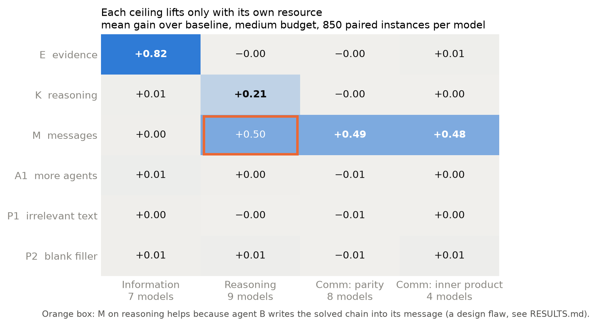
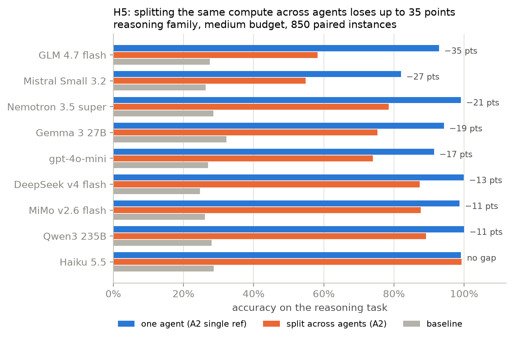
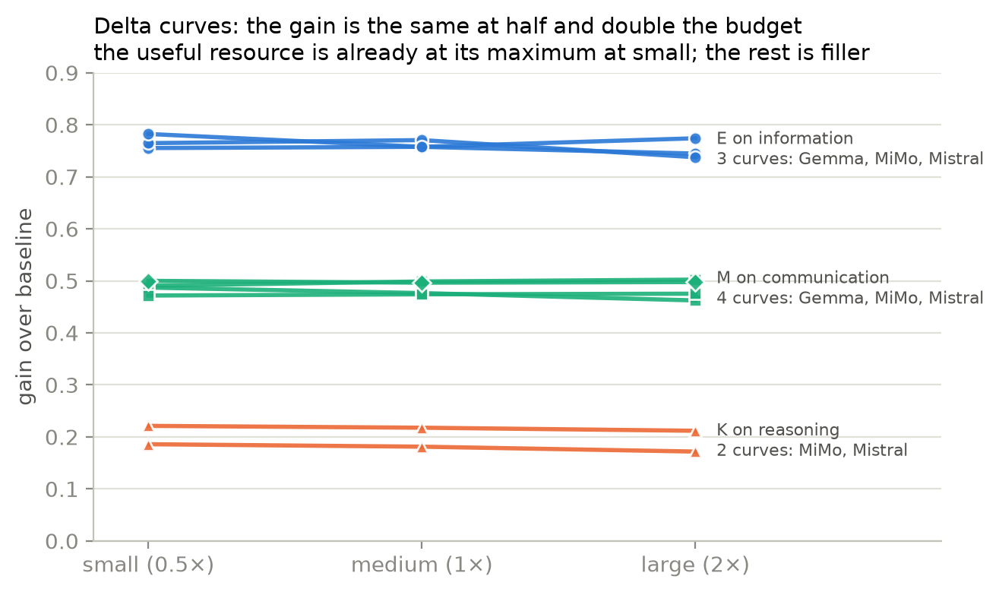

# Paid run on OpenRouter (October 2026)

The confirmatory run of the ceiling-discrimination experiment: ten models, the pre-registered
design frozen before the main grid (hash `7961e5c2…050f0e`, archived in
[prereg/design1/](prereg/design1/)), 850 paired instances per cell. Machine-readable outputs are in
[results/paid-2026-10/](results/paid-2026-10/); raw runs and transcripts are in `data/paid/` (not
committed). Departures from the plan are in [prereg/DEVIATIONS.md](prereg/DEVIATIONS.md) and in the
frozen config's `run_plan.deviations`.

**Checking every test against its run records later found that this run's K, M-on-reason and A2
arms did not test what they were meant to, so its H2 and H5 verdicts do not stand.** They were
fixed (arm design 2) and rerun on the reason family in November 2026; see
[Rerun under arm design 2](#rerun-under-arm-design-2-november-2026) below. The other verdicts are
unaffected.

## Verdicts

| Hypothesis | Verdict | Supported for | Inconclusive for | Not evaluable |
|---|---|---|---|---|
| H1 information: E helps; K, M, A1, P1, P2 do not | **supported** | Llama 3.3, Mistral Small 3.2 | DeepSeek, Gemma, Nemotron, Qwen, MiMo | Haiku, gpt-4o-mini, GLM |
| H2 reasoning: K helps; E, M, A1, P1, P2 do not | inconclusive (superseded by the rerun: still inconclusive) | none | DeepSeek, Mistral, gpt-4o-mini, MiMo, GLM | Haiku, Gemma, Llama, Nemotron, Qwen |
| H3 communication: M helps; K, E, A1, P1, P2 do not | inconclusive | Nemotron | DeepSeek, Qwen, MiMo | 6 others (comm_ip gate failed) |
| H4 A1 (more agents, same totals) gives no gain | inconclusive | Llama | DeepSeek, Mistral, gpt-4o-mini, MiMo, GLM | 4 |
| H5 A2 gain equals the same compute in one agent | inconclusive (superseded by the rerun: **supported**) | Llama | DeepSeek, Mistral, gpt-4o-mini, MiMo, GLM | 4 |
| H6 information error never significantly below the Fano floor | **supported** | DeepSeek, Nemotron, Qwen, MiMo | | |
| H7 inner product flat then rising; parity jumps at 1 bit | **supported** | DeepSeek, Nemotron, Qwen, MiMo | | |

The rule is pre-registered: a model supports a hypothesis only when every one of its support tests
rejects after Holm (superiority by exact McNemar for the matching arm, equivalence within ±0.05 by
Newcombe TOST for every other arm); a hypothesis needs two agreeing evaluable models. No hypothesis
was contradicted: no falsifier test rejected for any model.

**What the inconclusive verdicts mean.** In every family the matching arm helps on every model and
the other arms barely move accuracy, but at n = 850 many of those near-zero differences do not
pass equivalence at ±0.05 after Holm correction across the model's tests. The exceptions that are
real effects, not power, are listed below.

## Main grid (medium delta, 850 paired instances, gains over baseline)

| Family | Matching arm, gain range | Other arms | Models |
|---|---|---|---|
| info | E +0.76 to +0.87 | K, M, A1, A2, P1, P2 all within −0.03 to +0.03 | 7 |
| reason | K +0.12 to +0.30 | E, A1, P1, P2 within −0.04 to +0.06; **M +0.26 to +0.68** | 9 |
| comm_parity | M +0.44 to +0.53 | K, E, A1, P1, P2 within −0.05 to +0.05 | 8 |
| comm_ip | M +0.45 to +0.50 | all within −0.02 to +0.03 | 4 |

Every baseline is at chance (info 2^known/2^k, reason 0.25, comm 0.5). Full table: `tests.csv`,
`gain_table.csv`.

Findings that bear on the verdicts:

- **K on reason was out-voted.** At the matched cost, K reasoned on one of its four samples, and
  the three that did not reason out-voted it: the reasoning sample was right 90-100% of the time,
  the team's vote 40-57%. The gains above (+0.12 to +0.30) understate K by about 0.4-0.5. Fixed in
  the rerun.
- **M on reason is a design flaw, not a refutation.** Agent B writes the worked chain into its
  message, so M delivers the sender's compute as text: B states the target shift in 407 to 782 of
  850 messages, and M beats K on all 9 models. Under the frozen rule this blocks H2's support for
  every model. Fixed in the rerun (M passes only verbatim task lines).
- **A2 never split compute, so this run does not test H5.** A2 trails the single agent on reason
  by 0.11 to 0.35 on 8 of 9 models, but on those 8 cost matching chose depth "low": four agents with
  no reasoning stage, the budget spent on filler. Agent D answered cold, C and B mostly agreed, and A
  copied B 75-98% of the time; when D's first message was wrong, the team was right 8-58% of the
  time. On comm, A2's 0-bit channel meant B, C and D never made a call, and on info no agent had
  anything to pass on, so both arms sat at chance. The rerun replaces this result.
- **A1 on comm can only lose.** Agent B is one of the four answerers and sees its own ready-made
  message, while no agent sees both halves, so A1 shifts accuracy below baseline by up to 0.04
  (Qwen parity 0.425 vs 0.465). This works against H4's equivalence.
- **MiMo K on comm_parity is a small harm** (−0.05, 95% CI −0.09 to −0.02).

## Calibration gates

Two stages: the fix's lower bound ≥ 0.90 and the baseline near chance on 300 fresh gate instances,
then the baseline equivalent to chance within ±0.05 on the gate and main-grid baselines pooled
(about 1,150 instances).

| Model | info | reason | comm_parity | comm_ip |
|---|---|---|---|---|
| Claude Haiku 5.5 | fail | fail (stage 2, 0.290) | pass | fail |
| DeepSeek v4 flash | pass | pass | pass | pass |
| Gemma 3 27B | pass | fail (stage 2, 0.313) | pass | fail |
| GLM 4.7 flash | fail | pass | fail | fail |
| gpt-4o-mini | fail | pass | fail | fail |
| Llama 3.3 70B | pass | fail | pass | fail |
| MiMo v2.6 flash | pass | pass | pass | pass |
| Mistral Small 3.2 24B | pass | pass | pass | fail |
| Nemotron 3.5 super | pass | fail (stage 2, 0.282) | pass | pass |
| Qwen3 235B A22B | pass | fail (stage 2, 0.278) | pass | pass |

Qwen comm_parity was the closest stage-2 pass (0.475 against chance 0.5).

## Delta curves (small and large delta on Gemma, Mistral, MiMo)

The curves are wired correctly (8 arms × 2 levels × 850 instances per group, the same instances as
the main grid), and the gains are flat: E on info +0.74 to +0.78, K on reason +0.17 to +0.22, M on
comm +0.46 to +0.50 at every level, and the other arms stay within about ±0.06.

**They cannot show whether gains depend on cost level.** The matching arm already sits at its
useful maximum at small delta: E has 16 probes (10 for Gemma at small) on tasks that need far
fewer, M sends 1 bit on parity and the full 8-bit list on comm_ip. The extra budget at medium and large
for E and M is therefore filler. K deepens one sample's reasoning (medium, high, xhigh; for
Mistral small and medium are the same setting), but its gain stays flat because the three samples
that do not reason out-vote that one at every level (see K above), not because depth stops
helping. What the curves do show is that filler and
the wrong kind of resource add nothing at any level (Mistral comm_parity M even drops from 0.987 to
0.962, about 3 standard errors).

At small delta, 24 cells miss the ±5% cost target because the arm's cheapest setting already costs
more than half the baseline; the worst are Mistral reason A2_single_ref (+275%) and K (+97%). The
Gemma reason curve was stopped at 887 runs because its gate failed; those rows appear in
`gain_table.csv` as small and large cells of about 55 and should be ignored.

## H6 and H7 sweeps (DeepSeek, Nemotron, Qwen, MiMo; 100 instances per cell)

**H6** (info, k = 4, T ∈ {0…16} probes, flip rate p ∈ {0, 0.1, 0.2}): no cell's error is
significantly below the Fano floor after Holm, and every row used exactly T tool calls. The floor
is far from tight for these models: with noisy probes and many of them (p = 0.1 at T ≥ 6, p = 0.2
at T ≥ 8) error stays at 0.35 to 0.80 where the floor is 0.25 or below, so H6's support says the floor holds, not that models reach
it. Answer truncation weakens this sweep: on 16 options models spend the 400-token answer cap on
long probabilities, and Nemotron loses 11.9% of samples (up to 46% in one cell), which only adds
error.

**H7** (comm, 16 bits, message budget L ∈ {0…16}): parity jumps from 0.47–0.55 at L = 0 to
0.97–1.00 at L = 1 on all four models. The inner product stays at 0.40 to 0.58 through L = 12 to 14
and rises only at L = 16 (Qwen 0.61, MiMo 0.81, DeepSeek 0.82, Nemotron 0.88). Every message
carried at most L bits. The location of the rise is set by the protocol (B sends the first L bits
of its list, so the best possible accuracy below L = 16 is 0.5 + 0.5·2^−(16−L)), so it says nothing
about an optimal protocol. 78 of Qwen's 900 non-empty-budget messages were empty after retries.

## Integrity and quality

- `ceilings check` passed on all 356,287 rows: no answer leaks, private evidence stays private,
  message budgets and step counts hold, ledgers add up. `ceilings audit` passes everything except
  cost matching (52 cells off ±5%: 24 at medium, 24 at small, 4 at large). The medium misses are
  mostly 5 to 8%; the large ones are Qwen reason A2_single_ref −59%, Nemotron comm_ip K +30.5%,
  Nemotron info A2_single_ref −14.5%, Qwen comm_ip K −13%, Mistral reason A2_single_ref −12%.
- No invalid or refused runs. Temperature 0.7 is logged on every row, but Haiku's provider accepts
  neither temperature nor seed, so Haiku used its default sampling.
- Quality warnings: the comm reasoning stage hits its 512-token cap in most calls (up to 99% for
  Qwen); M messages needed retries for format on Haiku parity (50%) and Qwen comm_ip (46%), and the
  delivered message was wrong or empty in 52 of 850 Haiku parity runs; Gemma's info family at k = 2
  has only 96 distinct prompts (4 hosts × 24 row orders) behind 850 instances, so its tests count
  repeats as independent evidence (the instance generator now refuses repeats).
- Comm baselines track the parity of the agent's own list (53 to 94% of answers); the instance set
  has P(parity even) = 0.467, which explains Qwen's 0.465 baseline. Labels are balanced, so this
  cannot fake a gain.
- The main grid and the curves and sweeps each had an independent read-only audit; their findings
  are folded in above.

## Spend

| Phase | Cost |
|---|---|
| Calibration | $5.84 |
| Prepare (gates and cost matching) | $25.75 |
| Reason re-gate at d = 3 | $2.73 |
| Main grid | $182.22 |
| Delta curves and H6/H7 sweeps | $88.99 |
| Design-2 rerun (November 2026, below) | $10.29 |
| **Total (key usage)** | **$315.89** |

## Rerun under arm design 2 (November 2026)

The fixes are described in the README ("Design changes after the October 2026 paid run"):
- **K** answers only with samples that reason.
- **M on reason** passes only lines copied word for word from the task.
- **A2's** four agents all reason and relay partial work, and its single-agent reference is matched
  to A2's realized cost.

The rerun covers only what those fixes affect:
- the reason family, all 9 arms at the medium delta, n = 850 paired instances per cell;
- the 5 models whose reason gate passed, each at its gated difficulty.

**Setup:**
- The pre-registration (hash `a669f8f7…`, [prereg/](prereg/)) was frozen before any paid call.
- The paid run's reason gates were reused (they use only the baseline and K at xhigh on all
  samples, which design 2 does not change).
- The gate and main instances are the paid run's, so the two runs compare instance by instance.
- Outputs are in [results/design2-2026-11/](results/design2-2026-11/), raw runs in `data/design2/`
  (not committed).

| Model | Baseline | K | K gain (95% CI) | A2 | One agent, same compute | A2 − one agent | H5 |
|---|---|---|---|---|---|---|---|
| DeepSeek v4 flash | 0.25 | 1.00 | +0.75 (+0.72, +0.78) | 0.995 | 1.000 | −0.005 | supported |
| Mistral Small 3.2 | 0.26 | 0.79 | +0.52 (+0.48, +0.56) | 0.705 | 0.815 | −0.111 | inconclusive |
| gpt-4o-mini | 0.27 | 0.92 | +0.64 (+0.61, +0.68) | 0.892 | 0.907 | −0.015 | supported |
| MiMo v2.6 flash | 0.24 | 0.98 | +0.74 (+0.71, +0.77) | 0.999 | 0.985 | +0.014 | supported |
| GLM 4.7 flash | 0.27 | 0.92 | +0.65 (+0.61, +0.68) | 0.875 | 0.939 | −0.064 | inconclusive |

### H5: supported

- **Supported on three models.** Splitting the added compute across four reasoning agents gives
  the same accuracy as one agent with that compute on DeepSeek, gpt-4o-mini and MiMo (equivalent
  within ±0.05 after Holm).
- **Mistral and GLM are inconclusive.** A2 trails the single agent there (−0.11 and −0.06). The
  pre-registered falsifier tests only A2 beating the single agent, so this is not a contradiction.
  - On those two models, no relay message reached the 200-token cap.
  - When the first agent's answer looks wrong, the team still recovers in most runs, unlike
    design 1. This is from a rough parse of the messages.
  - So the gap looks like a real cost of relaying errors on weaker models rather than a wiring
    flaw.
- **Cost:** A2 costs 1.9-2.8× the medium target, as pre-registered, so it is compared at its own
  cost. Its reference came within 7% of it on every model.

### H2: still inconclusive

- **K now clearly helps on every model:** +0.52 to +0.75, against +0.12 to +0.30 under design 1's
  vote; exact McNemar p < 1e-95.
- **The other arms barely move accuracy.** E, M, A1, P1 and P2 shift it by −0.02 to +0.06.
- **Why inconclusive:** at n = 850, several of those differences do not pass equivalence at ±0.05
  after Holm correction (E and P2 fail on every model). No falsifier rejected.
- **M on reason** now carries only facts A already holds. Only 1 of its 4,250 messages arrived
  empty. It is slightly positive on DeepSeek and MiMo (+0.05): seeing the facts a second time helps
  a little.

### Integrity

- `ceilings check` passes every integrity and quality check on all 38,250 runs.
- All 5 reason gates pass stage 2 with the new baselines pooled in.
- `ceilings audit` flags 7 cost cells:
  - the 5 A2 cells, expected as above;
  - K on MiMo (−5.7%) and GLM (+8.6%), logged in [prereg/DEVIATIONS.md](prereg/DEVIATIONS.md).
- **Out of scope:** the H1, H3, H4, H6 and H7 entries in this rerun's `predictions.json`. They are
  not evaluable or reason-only, because the root holds only reason runs.

**Cost** ($10.29 in total):

| Phase | Cost |
|---|---|
| Cost matching | $0.39 |
| Live smoke test | $0.05 |
| Main grid | $9.85 |
