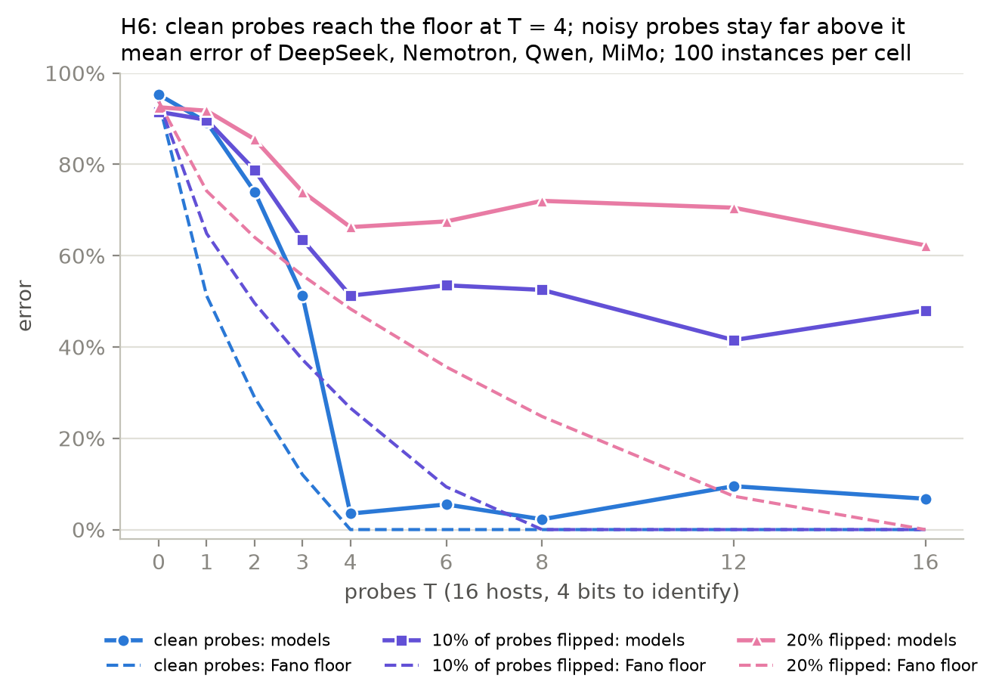
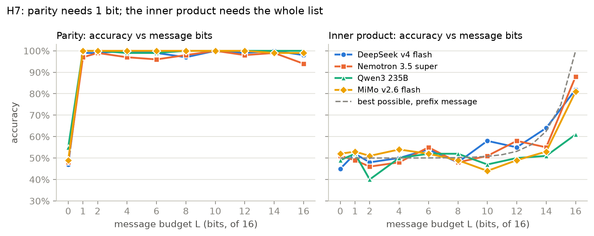

# Results

The ceiling-discrimination experiment ran on ten models on OpenRouter, with 850 paired instances
per cell and the design pre-registered before each run.

- **H1, H3, H4, H6 and H7** come from the October 2026 run:
  - pre-registration archived in [prereg/design1/](prereg/design1/), hash `7961e5c2…`;
  - outputs in [results/paid-2026-10/](results/paid-2026-10/).
- **H2 and H5** come from the November 2026 rerun of the reason family, with corrected K, M and A2
  arms (arm design 2; README, "Design changes after the October 2026 paid run"):
  - pre-registration archived in [prereg/design2/](prereg/design2/), hash `a669f8f7…`;
  - outputs in [results/design2-2026-11/](results/design2-2026-11/).
- **H5a, H5b and H5c** come from the November 2026 agent-team run (arm design 3,
  [prereg/DESIGN3_PLAN.md](prereg/DESIGN3_PLAN.md)):
  - pre-registration in [prereg/](prereg/), hash `ccfdafd2…`;
  - outputs in [results/design3-2026-11/](results/design3-2026-11/).
- Raw runs and transcripts are in `data/` (not committed). Departures from the plans are in
  [prereg/DEVIATIONS.md](prereg/DEVIATIONS.md).

## Verdicts

| Hypothesis | Verdict | Supported for | Inconclusive for | Not evaluable |
|---|---|---|---|---|
| H1 information: E helps; K, M, A1, P1, P2 do not | **supported** | Llama 3.3, Mistral Small 3.2 | DeepSeek, Gemma, Nemotron, Qwen, MiMo | Haiku, gpt-4o-mini, GLM |
| H2 reasoning: K helps; E, M, A1, P1, P2 do not | inconclusive | none | DeepSeek, Mistral, gpt-4o-mini, MiMo, GLM | 5 (reason gate failed) |
| H3 communication: M helps; K, E, A1, P1, P2 do not | inconclusive | Nemotron | DeepSeek, Qwen, MiMo | 6 (comm_ip gate failed) |
| H4 A1 (more agents, same totals) gives no gain | inconclusive | Llama | DeepSeek, Mistral, gpt-4o-mini, MiMo, GLM | 4 |
| H5 A2 (compute split across agents) equals the same compute in one agent | **supported** | DeepSeek, gpt-4o-mini, MiMo | Mistral, GLM | 5 (reason gate failed) |
| H5a no agent team beats one agent that spends as much | inconclusive | Mistral | MiMo, GLM | |
| H5b each team within ±0.05 of one agent that spends as much | **contradicted** (Mistral, GLM) | | MiMo | |
| H6 information error never significantly below the Fano floor | **supported** | DeepSeek, Nemotron, Qwen, MiMo | | |
| H7 inner product flat then rising; parity jumps at 1 bit | **supported** | DeepSeek, Nemotron, Qwen, MiMo | | |

**The rules are pre-registered:**
- A model supports a hypothesis only when every one of its support tests rejects after Holm:
  superiority by exact McNemar for the matching arm, and equivalence within ±0.05 by Newcombe TOST
  for every other arm.
- A hypothesis needs two agreeing evaluable models.
- No hypothesis from designs 1 and 2 was contradicted: no falsifier test rejected for any model.
  H5b (design 3) is contradicted on two models (below).

**What the inconclusive verdicts mean.** In every family the matching arm helps on every model,
and the other arms barely move accuracy. But at n = 850 many of those near-zero differences do not
pass equivalence at ±0.05 after Holm correction across the model's tests.

## Gains over baseline (medium delta)

| Family | Matching arm, gain range | Other arms | Models |
|---|---|---|---|
| info | E +0.76 to +0.87 | K, M, A1, P1, P2 within −0.03 to +0.03 | 7 |
| reason | K +0.52 to +0.75 | E, M, A1, P1, P2 within −0.02 to +0.06 | 5 |
| comm_parity | M +0.44 to +0.53 | K, E, A1, P1, P2 within −0.05 to +0.05 | 8 |
| comm_ip | M +0.45 to +0.50 | all within −0.02 to +0.03 | 4 |

Every baseline is at chance: info 2^known/2^k, reason 0.25, comm 0.5. The full tables are in each
results folder's `tests.csv` and `gain_table.csv`.

### Reasoning (H2 and H5)

| Model | Baseline | K | K gain (95% CI) | A2 | One agent, same compute | A2 − one agent |
|---|---|---|---|---|---|---|
| DeepSeek v4 flash | 0.25 | 1.00 | +0.75 (+0.72, +0.78) | 0.995 | 1.000 | −0.005 |
| Mistral Small 3.2 | 0.26 | 0.79 | +0.52 (+0.48, +0.56) | 0.705 | 0.815 | −0.111 |
| gpt-4o-mini | 0.27 | 0.92 | +0.64 (+0.61, +0.68) | 0.892 | 0.907 | −0.015 |
| MiMo v2.6 flash | 0.24 | 0.98 | +0.74 (+0.71, +0.77) | 0.999 | 0.985 | +0.014 |
| GLM 4.7 flash | 0.27 | 0.92 | +0.65 (+0.61, +0.68) | 0.875 | 0.939 | −0.064 |

**H2:**
- K helps on every model (exact McNemar p < 1e-95).
- H2 is inconclusive only because E and P2 fail equivalence on every model, and M, A1 or P1 on
  some.
- M on reason carries only lines copied from the task, so it gives A nothing new. It is slightly
  positive on DeepSeek and MiMo (+0.05): seeing the facts a second time helps a little.

**H5:**
- On DeepSeek, gpt-4o-mini and MiMo, four reasoning agents relaying partial work match one agent
  with the same compute.
- On Mistral and GLM, A2 trails, which is inconclusive rather than contradicted: the
  pre-registered falsifier tests only A2 beating the single agent. No relay message reached its
  200-token cap, and the team usually recovers when the first agent's answer looks wrong. So the
  gap looks like a real cost of relaying errors on weaker models.
- Four reasoning agents cost 1.9-2.8× the medium target, so, as pre-registered, A2 is compared
  with one agent matched to A2's own cost (within 7% on every model).

### Agent teams (H5a-H5c, arm design 3)

Three realistic team shapes, each compared with one agent that spends the same total tokens
(S_ref: the same model with more attempts and a majority vote, matched to the team's spend on 20
separate instances). Every agent holds every fact, so a team can only lose by how it divides and
passes on the work. The task is a chain of d shift offsets (GLM and Mistral d = 6, MiMo d = 12),
n = 300 paired instances (MiMo 250).

| Model | Alone (S) | Team | Team | S_ref | S_ref | Team − S_ref (95% CI) | S_ref spend vs team |
|---|---|---|---|---|---|---|---|
| Mistral Small 3.2 | 0.66 | L lead + workers | 0.610 | `max:4` | 0.733 | −0.123 (−0.190, −0.055) | +9% |
| | | W swarm, shared notes | 0.617 | `max:5` | 0.730 | −0.113 (−0.172, −0.053) | +19% |
| | | R author + reviewer | 0.597 | `max:3` | 0.667 | −0.070 (−0.140, +0.001) | +6% |
| GLM 4.7 flash | 0.61 | L | 0.597 | `max:3.5` | 0.733 | −0.137 (−0.202, −0.070) | −12% |
| | | W | 0.833 | `max:5.5` | 0.803 | +0.030 (−0.028, +0.088) | −1% |
| | | R | 0.613 | `max:3` | 0.713 | −0.100 (−0.169, −0.030) | +15% |
| MiMo v2.6 flash | 0.80 | L | 0.924 | `max:4.5` | 0.880 | +0.044 (−0.009, +0.098) | +38% |
| | | W | 0.912 | `max:7` | 0.920 | −0.008 (−0.058, +0.042) | +7% |
| | | R | 0.752 | `max:1.7` | 0.768 | −0.016 (−0.083, +0.051) | +14% |

**H5a (no team beats one agent that spends as much):**
- No team significantly beats its S_ref on any model (smallest Holm-adjusted superiority
  p = 0.20, MiMo L), so H5a is not contradicted.
- It is supported only on Mistral, where every team is shown to be no more than 0.05 better.
- It is inconclusive on GLM and MiMo: GLM's swarm (+0.030) and MiMo's lead-and-workers
  (+0.044) cannot rule out a gain of up to 0.09-0.10, and MiMo's R misses narrowly
  (Holm p = 0.053). MiMo's L beat a reference that spent 38%
  more than it on these instances, so at truly equal spend that gap could be larger.

**H5b (each team within ±0.05):** contradicted, as predicted, on Mistral and GLM, where teams
trail their reference by 0.07-0.14. Mistral's L and W and GLM's L lie wholly below −0.05. On
MiMo all three teams are within 0.05 of their reference, but n = 250 is too few to show
equivalence after Holm.

**H5c (mechanism, descriptive):**
- When a teammate sends a wrong claim about the target, the team's answer agrees with it 54-64%
  of the time in the teams that trail most (Mistral and GLM, L and R), and 39% in Mistral's
  swarm.
- The teams that keep up with their reference accept far fewer: GLM's swarm 20%, and MiMo's L
  and W 16-22%. MiMo's R is the exception: it accepts 76% but trails by only 0.016.
- Across the 9 model × team cells, the deficit rises with that acceptance share (Spearman ρ = 0.48,
  p = 0.19, not significant).
- Teammates' claims about people's shifts are right 61-75% of the time. The parser found claims in
  78-100% of reports, notes and reviews.

**What this shows.** Dividing the work never let a team beat one agent spending the same. Weaker
models lost 0.07-0.14 by trusting each other's mistakes. The exception is GLM's swarm (W), whose
peers each work the whole chain and vote, which made it match its reference. Splitting a chain
between workers (L) cost GLM and Mistral the most.

**Caveats:**
- The S_refs were matched on 20 instances. On the main instances 5 of 9 drifted more than 10%
  from their team ([DEVIATIONS](prereg/DEVIATIONS.md)). In 4 of those 5 the reference spent more,
  which favours it.
- `max:3.5` and `max:1.7` make one extra attempt on 50% and 70% of instances.

### Other findings

- **A1 on comm can only lose.** Agent B is one of the four answerers and sees its own ready-made
  message, while no agent sees both halves. So A1 shifts accuracy below baseline by up to 0.04
  (Qwen parity 0.425 vs 0.465), which works against H4's equivalence.
- **MiMo K on comm_parity is a small harm:** −0.05 (95% CI −0.09 to −0.02).

## Calibration gates

The gates have two stages:
1. On 300 fresh gate instances: the full fix's lower bound must be ≥ 0.90, and the baseline near
   chance.
2. On the gate and main-grid baselines pooled (about 1,150 instances): the baseline must be
   equivalent to chance within ±0.05.

| Model | info | reason | comm_parity | comm_ip |
|---|---|---|---|---|
| Claude Haiku 5.5 | fail | fail (stage 2, 0.290) | pass | fail |
| DeepSeek v4 flash | pass | pass | pass | pass |
| Gemma 3 27B | pass | fail (stage 2, 0.313) | pass | fail |
| GLM 4.7 flash | fail | pass | fail | fail |
| gpt-4o-mini | fail | pass | fail | fail |
| Llama 3.3 70B | pass | fail | pass | fail |
| MiMo v2.6 flash | pass | pass | pass | pass |
| Mistral Small 3.2 24B | pass | pass | pass | fail |
| Nemotron 3.5 super | pass | fail (stage 2, 0.282) | pass | pass |
| Qwen3 235B A22B | pass | fail (stage 2, 0.278) | pass | pass |

- The 5 reason passes also pass stage 2 with the rerun's baselines pooled in.
- Qwen comm_parity was the closest stage-2 pass (0.475 against chance 0.5).

## H6 and H7 sweeps (DeepSeek, Nemotron, Qwen, MiMo; 100 instances per cell)

**H6** (info, k = 4, T ∈ {0…16} probes, flip rate p ∈ {0, 0.1, 0.2}):
- No cell's error is significantly below the Fano floor after Holm, and every row used exactly T
  tool calls.
- The floor is far from tight for these models. With noisy probes and many of them (p = 0.1 at
  T ≥ 6, p = 0.2 at T ≥ 8), error stays at 0.35 to 0.80 where the floor is 0.25 or below. So H6's
  support says the floor holds, not that models reach it.
- Nemotron's answers were truncated at the 400-token answer cap in 11.9% of samples (up to 46% in
  one cell), which only adds error.

**H7** (comm, 16 bits, message budget L ∈ {0…16}):
- Parity jumps from 0.47–0.55 at L = 0 to 0.97–1.00 at L = 1 on all four models.
- The inner product stays at 0.40 to 0.58 through L = 12 to 14, and rises only at L = 16 (Qwen
  0.61, MiMo 0.81, DeepSeek 0.82, Nemotron 0.88).
- Every message carried at most L bits.

## Limitations

- **H6 and H7 are consistency checks.** They test information-theoretic bounds that no honest team
  can beat, so they could only fail through a leak or a bug. Under the fixed message format (B
  sends the first L bits of its list), H7's shape is set by the format: the best possible accuracy
  below L = 16 is 0.5 + 0.5·2^−(16−L).
- **M on reason is a null by construction,** and H4's A1 agents are four samples of the same model
  with no channel between them.
- **K in the October run reasoned on only some of its samples.** That under-measured K on reason
  (replaced by the rerun). On info and comm, its reasoning samples were within about 0.04 of the
  baseline's single samples, so H1 and H3 are unaffected.
- **The delta curves (small and large delta on Gemma, Mistral and MiMo) cannot show whether gains
  depend on cost.** E and M already sit at their useful maximum at small delta, so the extra
  budget is filler. They do show that filler and the wrong resource add nothing at any level.
- **Cost-matching misses (`ceilings audit`):**
  - October run: 12 medium cells outside ±5% in the arms the verdicts use, mostly 5-8%. The
    largest are Nemotron comm_ip K (+30.5%) and Qwen comm_ip K (−13%).
  - Rerun: K on MiMo (−5.7%) and GLM (+8.6%).
- **Quality warnings:**
  - The comm reasoning stage hits its 512-token cap in most calls (up to 99% for Qwen).
  - M's format needed retries on Haiku parity (50%) and Qwen comm_ip (46%).
  - Gemma's info family at k = 2 has only 96 distinct prompts behind 850 instances.
  - Qwen sent 78 empty H7 messages.
  - Haiku's provider ignores temperature and seed.
- **Comm baselines track the parity of the agent's own list** (53-94% of answers). The instance
  set has P(parity even) = 0.467, which explains Qwen's 0.465 baseline. Labels are balanced, so
  this cannot fake a gain.

## Integrity

- `ceilings check` passes on all 356,287 October rows and all 38,250 rerun rows: no answer leaks,
  private evidence stays private, message budgets and step counts hold, ledgers add up, and there
  are no invalid or refused runs.
- `ceilings check` passes on all 6,810 design-3 rows (matching and main), after two bookkeeping
  fixes recorded in DEVIATIONS (no run changed). No forced-answer rate is above 6%, and every
  lead used at least 2 workers.
- The October main grid, its curves and its sweeps each had an independent read-only audit, and two
  independent reviews checked the design-2 code before the rerun.

## Spend

| Phase | Cost |
|---|---|
| Calibration | $5.84 |
| Prepare (gates and cost matching) | $25.75 |
| Reason re-gate at d = 3 | $2.73 |
| Main grid | $182.22 |
| Delta curves and H6/H7 sweeps | $88.99 |
| Reason rerun (November 2026) | $10.29 |
| Agent teams, design 3: pilots $1.71, matching $1.84, main grid $8.38 | $11.93 |
| **Total (key usage)** | **$327.82** |
